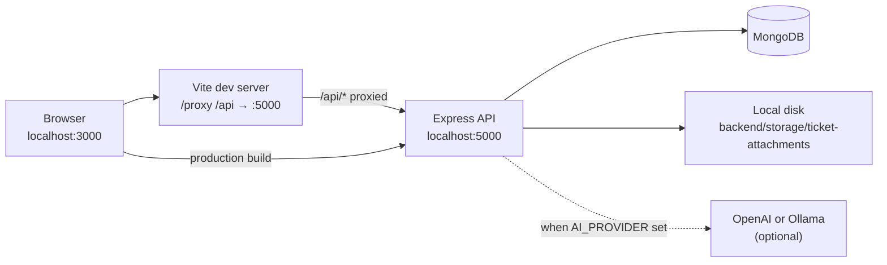

# BookLeaf Author Support & Communication Portal

Full-stack portal for BookLeaf publishing authors and internal support administrators. Authors browse their book catalogue, track royalties, and open support tickets. Administrators manage the ticket queue, review AI-assisted classifications and draft replies, and look up author context.

## Quick Start

Prerequisites: **Node.js 20+**, **npm**, and **MongoDB 6+** running locally.

### 1. Install dependencies

```bash
# Terminal 1 — backend
cd backend
npm install
cp .env.example .env
# Edit backend/.env (see Backend Environment below)

# Terminal 2 — frontend
cd frontend
npm install
cp .env.example .env
```

### 2. Configure and seed the database

Ensure MongoDB is reachable at the URI in `backend/.env` (default `mongodb://127.0.0.1:27017/bookleaf`).

Set seed variables in `backend/.env` (see [Database seeding](#database-seeding)). For local development, the project defines these demo values in `backend/src/modules/seed/constants.js`:

- Author password (new accounts): `Author@123`
- Admin password (new admin): `admin`

```bash
# From backend/
npm run seed
```

### 3. Start both applications (separate terminals)

```bash
# Terminal 1 — from backend/
npm run dev
# → http://localhost:5000

# Terminal 2 — from frontend/
npm run dev
# → http://localhost:3000
```

### 4. Sign in

| Role | Email (after seed) | Password (local demo) |
|------|--------------------|------------------------|
| Admin | Value of `ADMIN_EMAIL` in `backend/.env` (example: `admin@your-local-domain.test`) | Value of `ADMIN_PASSWORD` (local demo: `admin`) |
| Author | Any seeded author email, e.g. `priya.sharma@email.com` | `Author@123` (when created by seed) |

Open **http://localhost:3000**, sign in, and you will be routed to `/admin` or `/author` based on role.

---

## Features

### Author portal (`AUTHOR` role)

- Dashboard with royalty summaries derived from the book catalogue
- Paginated book list with title search
- Support ticket list, creation (with optional file attachment), and threaded conversation
- Account page showing session profile from `GET /api/v1/auth/me`

### Admin portal (`ADMIN` role)

- Dashboard with ticket queue counts
- Filterable ticket queue with assignment, status, and classification controls
- Ticket detail with public conversation, internal notes, and AI analysis/draft review
- Author directory with profile, books, royalty summary, and linked tickets
- Account page for the signed-in administrator

### Platform capabilities

- Cookie-based JWT authentication with CSRF protection on mutating auth requests
- Role-based authorization (`AUTHOR`, `ADMIN`)
- Optional AI ticket classification and draft generation (OpenAI or Ollama)
- Local disk storage for ticket attachments (PDF, PNG, JPG, GIF, TXT; max 5 MB)
- OpenAPI/Swagger documentation (non-production)
- Automated test suites for frontend (Vitest) and backend (Jest)

---

## Technology Stack

| Layer | Technologies |
|-------|--------------|
| Frontend | React 19, Vite 8, React Router 7, TanStack React Query 5, Axios, Tailwind CSS 4, Vitest |
| Backend | Node.js 20+, Express 4, Mongoose 8, Joi, JWT (HttpOnly cookie), bcryptjs, Multer |
| Database | MongoDB 6+ |
| API docs | OpenAPI 3.x, Swagger UI Express |
| AI (optional) | OpenAI API or local Ollama |

---

## Architecture



**Request flow (local development)**

1. The React app loads from the Vite dev server on port **3000**.
2. API calls use `VITE_API_BASE_URL=/api/v1` (default), so requests hit the same origin.
3. Vite proxies `/api` to `http://localhost:5000`.
4. The backend validates the session cookie, applies role checks, and reads/writes MongoDB.
5. Optional AI analysis runs in-process after ticket creation when `AI_PROVIDER` is configured.

---

## Repository Structure

```
Assign-ak/
├── README.md                 # This file — project entry point
├── backend/
│   ├── docs/                 # Sample dataset, API specs, audit reports
│   ├── scripts/              # seedDatabase.js, generateInvitation.js, validateOpenApi.js
│   ├── src/
│   │   ├── config/           # Environment, database, Swagger
│   │   ├── middleware/       # Auth, CSRF, validation, uploads
│   │   ├── modules/          # Domain modules (auth, books, tickets, admin, ai, seed, …)
│   │   └── routes/           # Route registration
│   ├── storage/              # Ticket attachments (gitignored; created at runtime)
│   ├── tests/                # Jest integration and unit tests
│   ├── .env.example
│   ├── package.json
│   └── README.md
└── frontend/
    ├── src/
    │   ├── app/              # Router, providers
    │   ├── features/         # auth, admin, author, books, dashboard, tickets
    │   ├── lib/              # API client, React Query, CSRF helpers
    │   └── layouts/          # Author, admin, public shells
    ├── .env.example
    ├── package.json
    ├── vite.config.js
    └── README.md
```

There is **no root-level `package.json`**. Start frontend and backend from their respective directories in separate terminals.

---

## Prerequisites

| Requirement | Version | Notes |
|-------------|---------|-------|
| Node.js | 20+ | Verified with v20.19.6 |
| npm | Bundled with Node | Used by both apps |
| MongoDB | 6+ | Local instance or hosted cluster |

Optional:

- **OpenAI API key** — when `AI_PROVIDER=openai`
- **Ollama** — when `AI_PROVIDER=ollama` (`ollama pull llama3.2` or your chosen model)

---

## Installation

### Backend

```bash
cd backend
npm install
cp .env.example .env
```

Edit `backend/.env` before starting the server. Required variables are validated at startup.

### Frontend

```bash
cd frontend
npm install
cp .env.example .env
```

If `npm install` fails with peer dependency conflicts, retry with:

```bash
npm install --legacy-peer-deps
```

---

## Environment Configuration

### Frontend (`frontend/.env`)

| Variable | Required | Default | Description |
|----------|----------|---------|-------------|
| `VITE_API_BASE_URL` | No | `/api/v1` | API base path or full URL |

Local development uses the Vite proxy (see `frontend/vite.config.js`), so the default `/api/v1` is correct. For a production build pointing at a remote API, set the full origin URL.

Example:

```env
VITE_API_BASE_URL=/api/v1
```

See [frontend/README.md](./frontend/README.md) for details.

### Backend (`backend/.env`)

| Variable | Required | Description |
|----------|----------|-------------|
| `PORT` | No (default `5000`) | HTTP port |
| `NODE_ENV` | No (default `development`) | `development`, `production`, or `test` |
| `MONGODB_URI` | **Yes** | MongoDB connection string |
| `CLIENT_URL` | **Yes** | Frontend origin for CORS (no trailing slash), e.g. `http://localhost:3000` |
| `JWT_SECRET` | **Yes** | Signing secret, minimum 32 characters |
| `JWT_EXPIRES_IN` | No (default `1d`) | Access token lifetime |
| `JWT_ISSUER` | No (default `bookleaf-api`) | JWT issuer claim |
| `JWT_AUDIENCE` | No (default `bookleaf-portal`) | JWT audience claim |
| `COOKIE_SAME_SITE` | No (default `lax`) | `strict`, `lax`, or `none` |
| `AUTH_COOKIE_PATH` | No (default `/`) | Auth cookie path |
| `LOGIN_RATE_LIMIT_MAX` | No (default `10`) | Max login attempts per IP per 15 minutes |

**Seed-only variables** (required to run `npm run seed`):

| Variable | Required for seed | Description |
|----------|-------------------|-------------|
| `SEED_CONFIRM` | **Yes** | Must be exactly `yes` |
| `SEED_AUTHOR_DEFAULT_PASSWORD` | **Yes** | Password for newly created author accounts (min 8 chars) |
| `ADMIN_EMAIL` | **Yes** | Email for the seeded administrator |
| `ADMIN_PASSWORD` | **Yes** | Password for the seeded administrator |
| `ALLOW_PRODUCTION_SEED` | No (default `false`) | Must be `true` only for approved production seeding |

**Optional AI variables** — omit `AI_PROVIDER` to disable AI entirely:

| `AI_PROVIDER` | Additional required variables |
|---------------|-------------------------------|
| `openai` | `OPENAI_API_KEY`, `OPENAI_MODEL` |
| `ollama` | `OLLAMA_BASE_URL`, `OLLAMA_MODEL` |

Optional: `AI_REQUEST_TIMEOUT_MS` (default `60000`).

See [backend/README.md](./backend/README.md) and [backend/.env.example](./backend/.env.example) for full AI and attachment notes.

**Cross-app alignment:** `CLIENT_URL` in the backend must match the browser origin serving the frontend (`http://localhost:3000` by default). The frontend does not store backend secrets.

---

## Database Setup

**Database:** MongoDB via Mongoose.

1. Start MongoDB locally or use a hosted cluster.
2. Set `MONGODB_URI` in `backend/.env`. Default local example:

   ```env
   MONGODB_URI=mongodb://127.0.0.1:27017/bookleaf
   ```

3. The application creates collections on first use. An empty database is fine before seeding.
4. Verify connectivity after starting the backend:

   ```bash
   curl http://localhost:5000/api/v1/health
   ```

   Expect `"database": "connected"` when MongoDB is reachable.

---

## Database Seeding

**Command (from `backend/`):**

```bash
npm run seed
```

This runs `node scripts/seedDatabase.js`, which calls `runSeed()` in `src/modules/seed/seed.service.js`.

### What the seed creates

| Data | Source | Count (full dataset) |
|------|--------|----------------------|
| Authors | `backend/docs/FULLSTACK-SAMPLEDATA (1) (1).json` | 10 author profiles |
| Books | Nested under each author in the same file | 18 book records |
| Admin user | `ADMIN_EMAIL` / `ADMIN_PASSWORD` from `.env` | 1 administrator |

The JSON dataset does not include passwords. The seed script hashes `SEED_AUTHOR_DEFAULT_PASSWORD` for **new** author accounts and `ADMIN_PASSWORD` for a **new** admin account.

### Seed behavior

- **Idempotent:** Re-running updates author profiles and book fields via upsert. It does **not** overwrite existing password hashes, roles, `tokenVersion`, or `isActive` on existing accounts.
- **Does not delete** existing tickets, messages, or unrelated data.
- **Verification:** After import, royalty totals and author/book relationships are validated. Failures abort with an error summary.
- **Safety guards:** Refuses demo passwords in production, blocks production-like database names without `ALLOW_PRODUCTION_SEED=true`, and requires `SEED_CONFIRM=yes`.

### Local demo workflow

1. Ensure MongoDB is running and `backend/.env` is configured.
2. Set seed variables (see `backend/.env.example`).
3. Run `npm run seed` from `backend/`.
4. The script prints counts and verification results. It does **not** print passwords.

**Demo author login:** any seeded email (e.g. `priya.sharma@email.com`) with password `Author@123` if the account was created by seed with that default.

**Demo admin login:** the email and password you set as `ADMIN_EMAIL` / `ADMIN_PASSWORD`.

### Author registration (outside seed)

Authors can also register via `POST /api/v1/auth/register` with a one-time invitation token. Generate invitations from `backend/`:

```bash
node scripts/generateInvitation.js --email priya.sharma@email.com --author-id AUTH001 --name "Priya Sharma"
```

Administrators are **not** created through public registration.

### Database reset

There is **no** verified reset or drop script in this repository. To start from a clean database during development, manually drop the MongoDB database or use a fresh database name in `MONGODB_URI`, then run `npm run seed` again.

---

## Running the Applications

### Backend (development)

```bash
cd backend
npm run dev
```

Runs `node --watch src/server.js`. Default URL: **http://localhost:5000**.

### Backend (production-style)

```bash
cd backend
npm start
```

Runs `node src/server.js` without file watching.

### Frontend (development)

```bash
cd frontend
npm run dev
```

Runs Vite on **http://localhost:3000** with `/api` proxied to port 5000.

### Frontend (production build)

```bash
cd frontend
npm run build
npm run preview
```

Set `VITE_API_BASE_URL` to your deployed API origin before building for production.

### Running both simultaneously

Use **two terminals**:

| Terminal | Directory | Command |
|----------|-----------|---------|
| 1 | `backend/` | `npm run dev` |
| 2 | `frontend/` | `npm run dev` |

Start MongoDB and complete seeding before signing in.

---

## Tests

| App | Command (from app directory) | Framework | Verified |
|-----|------------------------------|-----------|----------|
| Backend | `npm test` | Jest + mongodb-memory-server + Supertest | Yes — 256 tests passed |
| Backend | `npm run test:watch` | Jest watch mode | Documented from `package.json` |
| Frontend | `npm test` | Vitest + Testing Library | Yes — 166 tests passed |
| Frontend | `npm run test:watch` | Vitest watch mode | Documented from `package.json` |
| Frontend | `npm run lint` | oxlint | Yes — exits 0 (warnings only) |
| Backend OpenAPI | `npm run validate:openapi` | swagger-parser | Yes — spec validates |

Backend tests do not require a running MongoDB instance or real AI credentials (providers are mocked).

---

## API Documentation

When the backend runs with `NODE_ENV` ≠ `production`:

| Resource | URL |
|----------|-----|
| Swagger UI | http://localhost:5000/api-docs |
| OpenAPI JSON | http://localhost:5000/api-docs/openapi.json |
| Health check | http://localhost:5000/api/v1/health |

Validate the spec without starting the server:

```bash
cd backend
npm run validate:openapi
```

Source files: `backend/docs/api/`. See [backend/docs/api/README.md](./backend/docs/api/README.md).

---

## AI Provider Configuration (Optional)

AI is **disabled** when `AI_PROVIDER` is unset. Ticket creation, manual classification, and admin replies work without AI.

| Provider | Set | Required env vars |
|----------|-----|-------------------|
| OpenAI | `AI_PROVIDER=openai` | `OPENAI_API_KEY`, `OPENAI_MODEL` |
| Ollama | `AI_PROVIDER=ollama` | `OLLAMA_BASE_URL`, `OLLAMA_MODEL` |

Rules:

- Only the selected provider is validated at startup.
- No automatic fallback to another provider after failures.
- Background analysis retries transient errors up to 2 times; it is not durable across process restarts.
- Changing providers requires updating `.env` and restarting the backend.

---

## File Upload and Storage

Ticket attachments are stored on **local disk** at `backend/storage/ticket-attachments/` (gitignored). Files are not served publicly; authors and admins download via authenticated API routes.

| Setting | Value |
|---------|-------|
| Max size | 5 MB |
| Allowed types | PDF, PNG, JPG/JPEG, GIF, TXT |
| Form field name | `attachment` |

The upload directory is created automatically when needed.

---

## Authentication and Roles

| Role | Access |
|------|--------|
| `AUTHOR` | `/author/*` — books, tickets, account |
| `ADMIN` | `/admin/*` — queue, ticket detail, authors, account |

Authentication uses an **HttpOnly cookie** (`bookleaf_access_token`) containing a signed JWT. Tokens are not returned in JSON bodies.

Mutating auth endpoints require a CSRF token from `GET /api/v1/auth/csrf-token`:

1. `GET /api/v1/auth/csrf-token`
2. Send `x-csrf-token` header on `POST /login`, `POST /logout`, `POST /register`
3. Include cookies (`credentials: 'include'` / Axios `withCredentials: true`)

`POST /api/v1/auth/logout` increments server-side `tokenVersion`, invalidating copied tokens.

---

## Troubleshooting

| Symptom | Likely cause | Fix |
|---------|--------------|-----|
| Backend fails at startup with env error | Missing/invalid `.env` | Copy `backend/.env.example`, set `MONGODB_URI`, `CLIENT_URL`, `JWT_SECRET` (32+ chars) |
| `Service unavailable` on `/health` | MongoDB not running | Start MongoDB; check `MONGODB_URI` |
| CORS or cookie issues | `CLIENT_URL` mismatch | Set `CLIENT_URL=http://localhost:3000` to match the frontend origin |
| Login returns 403 CSRF | Missing CSRF header | Frontend fetches CSRF automatically; ensure API calls go through the proxy in dev |
| Seed refuses to run | `SEED_CONFIRM` not `yes` | Set `SEED_CONFIRM=yes` and all seed variables in `backend/.env` |
| Seed password error in production | Demo passwords blocked | Use strong credentials and `ALLOW_PRODUCTION_SEED=true` only when explicitly approved |
| Frontend API network errors | Backend not running | Start `npm run dev` in `backend/` first |
| AI features unavailable | `AI_PROVIDER` unset or misconfigured | Configure provider vars or leave AI disabled |
| Attachment upload fails | Wrong type or size | Use allowed types; max 5 MB |
| `npm install` peer dependency errors (frontend) | Peer conflict | Retry with `npm install --legacy-peer-deps` |

---

## Further Documentation

- [Frontend README](./frontend/README.md) — routes, React Query, API client, frontend troubleshooting
- [Backend README](./backend/README.md) — modules, seed safety, auth details, admin status transitions
- [API conventions](./backend/docs/api/architecture.md)
- [Endpoint inventory](./backend/docs/api/endpoint-inventory.md)
- [Cross-layer audit report](./backend/docs/ASSIGNMENT-CROSS-LAYER-AUDIT-REPORT.md)

---

## Known Limitations

- No monorepo scripts to start both apps from the repository root.
- No Docker or deployment configuration in this repository.
- No automated database reset script; manual MongoDB cleanup required for a full wipe.
- Swagger UI is disabled when `NODE_ENV=production`.
- AI background processing is in-process and does not survive server restarts.
- Some admin/author UI areas document remaining API gaps (see feature `constants/apiGaps.js` files).
